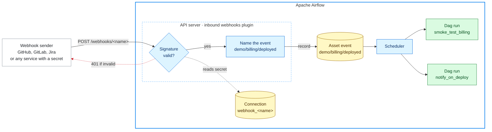

<p align="center">
  <picture>
    <source media="(prefers-color-scheme: dark)" srcset="docs/images/logo-dark.svg">
    
  </picture>
</p>

<h3 align="center">Turn incoming webhooks into asset events that trigger your Airflow Dags.</h3>

<p align="center">
  <a href="https://github.com/dheerajturaga/airflow-provider-inbound-webhooks/actions/workflows/ci.yml"></a>
  
  
</p>

`airflow-provider-inbound-webhooks` lets any service that can send a signed or secret-carrying
webhook trigger your [Apache Airflow](https://airflow.apache.org/) Dags.

Each verified delivery becomes an **asset event**, named after what happened. A Dag subscribes by
scheduling on that name, and Airflow does the rest. There is no routing code to write, and adding a
sender is one Airflow connection.

GitHub, GitLab and Jira are built in, with more services on the way. Any other service that signs
its deliveries with HMAC-SHA256 or sends a secret header works today, described in its connection.

```python
@dag(schedule=Asset("demo/billing/deployed"))
def smoke_test_billing(): ...
```

## Why

Airflow can be triggered from outside through its REST API, but webhook senders can't use it: they
cannot obtain or attach an Airflow API token. They sign their requests with a shared secret instead,
and each service posts its own payload format. The usual workarounds are a relay service in front of
Airflow, or sensors that poll the other service and hold worker or triggerer capacity while they
wait.

This plugin adds the missing piece: an endpoint on the Airflow API server that verifies each
service's signature and records the delivery as an asset event.

## Quick start

Try it with the bundled test sender, so no third-party account is needed. Run these commands on the
machine running the Airflow API server (Airflow 3.1.1 or later).

1. **Install the plugin:**

   ```bash
   pip install airflow-provider-inbound-webhooks "apache-airflow==$(airflow version)"
   ```

   Pinning `apache-airflow` to the version you run keeps pip from changing it.

2. **Enable the webhook name** `demo`, then restart the API server. The plugin serves only the names
   listed in [`webhook_names`](#configuration), so add this to `airflow.cfg` in your Airflow home:

   ```ini
   [inbound_webhooks]
   webhook_names = demo
   ```

   Or set `AIRFLOW__INBOUND_WEBHOOKS__WEBHOOK_NAMES=demo` in the API server's environment. After the
   restart, `airflow plugins` lists `webhooks`.

3. **Create the webhook.** It is a connection, named `webhook_demo` for the URL `/webhooks/demo`:

   ```bash
   airflow connections add webhook_demo --conn-type inbound_webhook --conn-password 'change-me' \
     --conn-extra '{"source_type": "hmac_json", "signature_header": "X-Signature",
                    "event_field": "event", "path_field": "service"}'
   ```

   <details>
   <summary>Or in the Airflow UI</summary>

   Under Admin → Connections, add a connection of type **Inbound Webhook**:

   | Field | Value |
   |---|---|
   | Connection Id | `webhook_demo` |
   | Shared secret | `change-me` |
   | Source type | `hmac_json` |
   | Signature header | `X-Signature` |
   | Event field | `event` |
   | Path field | `service` |

   </details>

4. **Add a Dag** that runs on the event, and unpause it, since new Dags start paused:

   ```bash
   dags_folder="$(airflow config get-value core dags_folder)"
   mkdir -p "$dags_folder"
   cat > "$dags_folder/quickstart.py" <<'EOF'
   """Quick start Dag: runs when the ``demo`` webhook receives a ``deployed`` event for the ``billing`` service."""

   from __future__ import annotations

   from airflow.sdk import Asset, dag, task

   billing_deployed = Asset("demo/billing/deployed")


   @dag(schedule=billing_deployed)
   def smoke_test_billing():
       @task
       def smoke_test(*, triggering_asset_events=None):
           # One run can carry several deliveries (always possible before Airflow 3.4).
           for event in triggering_asset_events[billing_deployed]:
               print(f"Smoke-testing billing after deployment: {event.extra['payload']}")

       smoke_test()


   smoke_test_billing()
   EOF
   airflow dags reserialize  # parse it now rather than at the next scan of the Dags folder
   airflow dags unpause smoke_test_billing
   ```

5. **Send a signed test delivery** with the test sender the package includes:

   ```bash
   python -m airflow_inbound_webhooks.send_test_event \
     --url http://localhost:8080/webhooks/demo --secret 'change-me' \
     --data '{"event": "deployed", "service": "billing"}'
   ```

   It prints the response, and `smoke_test_billing` starts a run:

   ```text
   HTTP 202
   {"status":"accepted","asset_events":{"demo/billing/deployed":1},"candidates":["demo/billing/deployed","demo/*/deployed"]}
   ```

   Anything else? See [Responses and troubleshooting](#responses-and-troubleshooting).

A webhook's connection is read again within a minute of a change, so changing its secret or options
needs no restart. Adding a webhook does, because its name must be added to `webhook_names`.

## Connect a service

Every service takes the same steps: in Airflow, enable the webhook's name and create a connection
holding a secret; in the service, add a webhook with that secret; then, in Airflow, schedule a Dag on
one of its events.

| Service | Source type | Setup |
|---|---|---|
| GitHub | `github`, built in | [Connect GitHub](#connect-github) |
| GitLab | `gitlab`, built in | [Connect GitLab](#connect-gitlab) |
| Jira | `jira`, built in | [Connect Jira](#connect-jira) |
| Any service that signs the body with HMAC-SHA256 | `hmac_json`, described in the connection | [Connect any other service](#connect-any-other-service) |
| Any service that sends a secret in a header | `token_header`, described in the connection | [Connect any other service](#connect-any-other-service) |

More built-in services are on the way. To ask for one, [open a feature request](https://github.com/dheerajturaga/airflow-provider-inbound-webhooks/issues/new?template=feature_request.yml)
with a link to the service's webhook documentation.

Before you start:

- The plugin is installed on the API server: [Quick start](#quick-start), step 1.
- The service can reach the API server. A cloud service, such as GitHub.com, GitLab.com or Jira
  Cloud, needs a public HTTPS address: put a reverse proxy in front of the API server that forwards
  only the paths of your webhooks, such as `/webhooks/github` (see [Security](#security)).
  `<your-airflow>` below stands for that address.

### Connect GitHub

**In Airflow**

1. Add `github` to [`webhook_names`](#configuration), the comma-separated list in `airflow.cfg`,
   and restart the API server.

2. Create the connection `webhook_github` with a new secret, and copy the secret it prints:

   ```bash
   SECRET="$(openssl rand -hex 32)" && echo "$SECRET"
   airflow connections add webhook_github --conn-type inbound_webhook --conn-password "$SECRET"
   ```

**In GitHub**

3. In the repository, open **Settings → Webhooks → Add webhook**. To cover every repository of an
   organization, use the organization's **Settings → Webhooks** instead, as an organization owner.

4. Fill in the form, then select **Add webhook**:

   | Field | Value |
   |---|---|
   | Payload URL | `https://<your-airflow>/webhooks/github` |
   | Content type | `application/json`. The default, `application/x-www-form-urlencoded`, is refused. |
   | Secret | The secret from step 2 |
   | Which events would you like to trigger this webhook? | **Let me select individual events**, then the ones your Dags need, such as *Pull requests* or *Pushes* |
   | Active | Checked |

5. Check it. GitHub sends a `ping` right away: on the webhook's **Recent Deliveries** tab it should
   have a green check, and its response should be `202` with `"status":"no_subscribers"`.

**In Airflow**

6. Add a Dag that schedules on an event, such as
   `Asset("github/my-org/web/pull_request/labeled/deploy-preview")`, and unpause it. To find a name,
   trigger the event once and copy one of the `candidates` from its response under **Recent
   Deliveries**, or see [Event names](#event-names).

### Connect GitLab

**In Airflow**

1. Add `gitlab` to [`webhook_names`](#configuration), the comma-separated list in `airflow.cfg`,
   and restart the API server.

2. Create the connection `webhook_gitlab` with a new secret, and copy the secret it prints:

   ```bash
   SECRET="$(openssl rand -hex 32)" && echo "$SECRET"
   airflow connections add webhook_gitlab --conn-type inbound_webhook --conn-password "$SECRET"
   ```

**In GitLab**

3. In the project, open **Settings → Webhooks → Add new webhook**. To cover every project of a group,
   use the group's **Settings → Webhooks** instead, as a group owner (GitLab Premium).

4. Fill in the form, then select **Add webhook**:

   | Field | Value |
   |---|---|
   | URL | `https://<your-airflow>/webhooks/gitlab` |
   | Secret token | The secret from step 2. GitLab also offers a *Signing token*, which this plugin does not check yet; you can set both. |
   | Trigger | The events your Dags need, such as *Push events*, *Merge request events* or *Pipeline events* |
   | Enable SSL verification | Checked |

5. Check it. In the list of webhooks, select **Test → Push events**. GitLab should report `HTTP 202`;
   **Edit → Recent events → View details** shows the response.

**In Airflow**

6. Add a Dag that schedules on an event, such as `Asset("gitlab/platform/api/pipeline/success")`, and
   unpause it. To find a name, trigger the event once and copy one of the `candidates` from its
   response under **Recent events**, or see [Event names](#event-names).

### Connect Jira

**In Airflow**

1. Add `jira` to [`webhook_names`](#configuration), the comma-separated list in `airflow.cfg`,
   and restart the API server.

2. Create the connection `webhook_jira` with a new secret, and copy the secret it prints:

   ```bash
   SECRET="$(openssl rand -hex 32)" && echo "$SECRET"
   airflow connections add webhook_jira --conn-type inbound_webhook --conn-password "$SECRET"
   ```

**In Jira**, as a Jira administrator

3. Open **Settings (⚙) → System → WebHooks → Create a WebHook**. On Jira Data Center, the menu is
   **Administration (⚙) → System → WebHooks**.

4. Fill in the form, then create the webhook:

   | Field | Value |
   |---|---|
   | Name | Any, such as `Airflow` |
   | Status | Enabled |
   | URL | `https://<your-airflow>/webhooks/jira` |
   | Secret | The secret from step 2. Jira cannot show it again once saved. |
   | Issue related events | A JQL filter such as `project = OPS`, and the events your Dags need, such as issue *created* and *updated* |
   | Exclude body | Unchecked |

**In Airflow**

5. Add a Dag that schedules on an event, such as
   `Asset("jira/OPS/issue_updated/status/Ready for Deploy")`, and unpause it. See [`jira`](#jira) for
   the names Jira events get.

6. Check it by making that change in Jira, here moving an `OPS` issue to *Ready for Deploy*: the Dag
   starts a run. Jira does not show webhook responses, so if nothing happens, check the API server
   log: it reports a delivery whose secret does not match, or a misconfigured connection. Otherwise
   check that `jira` is in `webhook_names`, that *Exclude body* is unchecked and that the Dag is
   unpaused. With `[logging] logging_level = DEBUG` on the API server, the log also lists the names a
   delivery offered when no Dag schedules on any of them.

### Connect any other service

For a service without a built-in source type, such as a deploy tool named `deploybot` here, you
describe its deliveries in the connection.

**In the service's webhook documentation**, find:

| What | For example | Connection option |
|---|---|---|
| How it authenticates deliveries | An HMAC-SHA256 signature of the body, or the secret itself, in a header | `source_type`: `hmac_json` or `token_header` |
| The header, and any text before the signature or secret | `X-Signature: sha256=<hex>` | `signature_header` and `signature_prefix`, or `token_header` and `token_prefix` |
| Where the event is named | `{"type": "deployed"}` in the body, or a header | `event_field` or `event_header` |
| Optionally, where a project or service is named | `{"service": "billing"}` | `path_field` |

**In Airflow**

1. Add `deploybot` to [`webhook_names`](#configuration), the comma-separated list in `airflow.cfg`,
   and restart the API server.

2. Create the connection `webhook_deploybot` with a new secret and those options, and copy the secret
   it prints:

   ```bash
   SECRET="$(openssl rand -hex 32)" && echo "$SECRET"
   airflow connections add webhook_deploybot --conn-type inbound_webhook --conn-password "$SECRET" \
     --conn-extra '{"source_type": "hmac_json", "signature_header": "X-Signature",
                    "signature_prefix": "sha256=", "event_field": "type", "path_field": "service"}'
   ```

   [`hmac_json`](#hmac_json-services-that-sign-the-body) and
   [`token_header`](#token_header-services-that-send-a-secret-header) list every option, and the
   **Inbound Webhook** connection form in the Airflow UI has a field for each.

**In the service**

3. Add a webhook with the URL `https://<your-airflow>/webhooks/deploybot` and the secret from step 2,
   sending JSON.

**In Airflow**

4. Add a Dag that schedules on an event, such as `Asset("deploybot/billing/deployed")`, and unpause
   it. To find a name, send the event once and copy one of the `candidates` from the response, or see
   [Event names](#event-names).

A service whose signature covers more than the body, such as a timestamp, or that needs a handshake
when the webhook is registered, needs a built-in source type: see [Other services](#other-services).

## How it works



The plugin never runs Dags itself. It records asset events, Airflow queues every Dag that schedules
on them, and the scheduler creates the runs. So one delivery can start several Dags, paused Dags stay
paused, and asset expressions such as `a | b` work as usual.

## Event names

Every delivery is named `<webhook name>/<path>/<event>/<action>/<detail>`, and every prefix of that
name can be subscribed to. Each prefix is also offered with `*` in place of each trailing part of
the path, so `*` stands for anything below that point. For the quick start delivery the names are:

```text
demo/billing/deployed     billing deployments
demo/*/deployed           deployments of any service
```

When a label is added to a pull request, the built-in GitHub source offers nine names, from broad to
specific:

```text
github/my-org/web/pull_request                           any pull request activity in my-org/web
github/my-org/*/pull_request                             ... in any repository of my-org
github/*/pull_request                                    ... in any repository
github/my-org/web/pull_request/labeled                   any label added
github/my-org/*/pull_request/labeled
github/*/pull_request/labeled
github/my-org/web/pull_request/labeled/deploy-preview    the deploy-preview label added
github/my-org/*/pull_request/labeled/deploy-preview
github/*/pull_request/labeled/deploy-preview
```

Deeper paths work the same way. For a GitLab project `platform/backend/api`,
`gitlab/platform/backend/*/...` covers the `backend` subgroup, `gitlab/platform/*/...` the whole
`platform` group, subgroups included, and `gitlab/*/...` every project.

**Finding a name:** every response lists the names it offered as `candidates`, so send the event
once and copy one. A delivery that matches no subscribed name is answered with
`202 no_subscribers` and nothing is stored.

Non-ASCII characters are folded (`🚀 deploy` → `deploy`) on every database, because MySQL stores
asset names as latin1 and fails any lookup that includes a non-ASCII name. Parts that end up empty
are dropped, so no name contains `//`: a path `ops/🚀/api` becomes `ops/api`, and a label `🚀` adds
no detail.

**Stability:** event names are a public interface (see [Versioning](#versioning)), and the one most
easily broken, because a Dag whose name stops matching does not fail; it just stops running.
Changing a name that an existing delivery produces, for example how it is normalized or what its
detail is, is a breaking change, and the [changelog](CHANGELOG.md) lists the old and new names under
"Changed event names". Adding names, such as a detail for an event that had none, is not, because
the shorter names are still offered.

## Source types

The connection's `source_type` decides how deliveries are verified and named. `hmac_json` and
`token_header` work with any service and are configured through connection options; the others are
built in for one service each. It defaults to the webhook name, so `webhook_github`,
`webhook_gitlab` and `webhook_jira` need nothing but a password.

| `source_type` | Authentication | Path | Event / action / detail | Stored payload |
|---|---|---|---|---|
| `hmac_json` | HMAC-SHA256 signature of the body | `path_field` value | `event_field` or `event_header` value | The body |
| `token_header` | Shared secret in a header | `path_field` value | `event_field` or `event_header` value | The body |
| `github` | `X-Hub-Signature-256` | `org/repo`, or `org/*` for organization events | see [`github`](#github) | The body |
| `gitlab` | `X-Gitlab-Token` | `group/subgroup/project` | see [`gitlab`](#gitlab) | The body |
| `jira` | `X-Hub-Signature` | project key | see [`jira`](#jira) | A summary; see [`jira`](#jira) |

Each asset event stores the delivery's body as `extra["payload"]`, as received, unless every
delivery also carries a full copy of the object it is about. Of the built-in services only Jira does,
sending the whole issue each time, so `jira` stores a summary by default.

### `hmac_json`: services that sign the body

For services that sign the raw body with HMAC-SHA256 and send the digest in a header. Prefer this
over `token_header` whenever a service can sign, because the signature also proves the body was not
changed.

| Extra field | Required | Meaning |
|---|---|---|
| `signature_header` | yes | Header carrying the signature |
| `signature_prefix` | no | Text before the digest, e.g. `sha256=` or `v1=` |
| `signature_encoding` | no | `hex` (default) or `base64` |
| `event_field` or `event_header` | one of them | Dotted path into the JSON body (`data.type`), or a header, naming the event. Prefer `event_field` when the service names the event in both: the signature covers the body but not the headers |
| `path_field` | no | Dotted path to a value that becomes the path, such as a service or project name |

### `token_header`: services that send a secret header

For services that can only send the shared secret in a header you configure. A bare token proves
who sent a delivery but not that it was unmodified, so it relies on TLS.

| Extra field | Required | Meaning |
|---|---|---|
| `token_header` | yes | Header carrying the secret, e.g. `Authorization` |
| `token_prefix` | no | Text before the secret, e.g. `"Bearer "` |
| `event_field` or `event_header` | one of them | As for `hmac_json` |
| `path_field` | no | As for `hmac_json` |

### `github`

GitHub.com and GitHub Enterprise Server. An organization webhook covers every repository in the
organization.

Names use GitHub's own event and action names. The detail is the label for `labeled` and
`unlabeled`, the branch for `push` (tag pushes have none), and the workflow name for
`workflow_run`. A second GitHub instance is a second connection, e.g. `webhook_ghes` with extra
`{"source_type": "github"}`.

### `gitlab`

GitLab.com and self-managed GitLab. Group webhooks cover every project in a group (a GitLab Premium
feature); otherwise add the webhook per project. To subscribe to every project in a group,
subgroups included, use `gitlab/<group>/*/...`. GitLab sends the secret token itself rather than
signing the body.

Names use the payload's `object_kind`, then `object_attributes.action` (or its `status`, for
pipelines). The detail is the branch for `push` and the tag for `tag_push`. GitLab has no label
events, so a label added to a merge request or issue is reported as `<object_kind>/labeled/<label>`.

### `jira`

Jira Cloud and Jira Data Center. Events are named from the body, so the webhook must not exclude
it. Webhooks that Connect or OAuth 2.0 apps register are authenticated differently and not
supported.

Names use the payload's `webhookEvent` without its `jira:` prefix, under the issue's project key.
The detail is the issue type for `issue_created`. `issue_updated` offers a name for each field in
the changelog, with the new status for status changes and, as for GitLab,
`issue_updated/labeled/<label>` for each label added. Moving an issue of project `OPS` to *Ready for
Deploy* and adding the label `hotfix` offers:

```text
jira/OPS/issue_updated                            any change to an OPS issue
jira/*/issue_updated                              ... in any project
jira/OPS/issue_updated/status                     any transition
jira/*/issue_updated/status
jira/OPS/issue_updated/status/Ready for Deploy    moved to Ready for Deploy
jira/*/issue_updated/status/Ready for Deploy
jira/OPS/issue_updated/labels                     any change to the labels
jira/*/issue_updated/labels
jira/OPS/issue_updated/labeled                    any label added
jira/*/issue_updated/labeled
jira/OPS/issue_updated/labeled/hotfix             the hotfix label added
jira/*/issue_updated/labeled/hotfix
```

Field names are the changelog's, such as `Story Points` for a custom field. Events about neither an
issue nor a project, such as `sprint_started`, have no path: `jira/sprint_started`.

Jira sends the whole issue, every custom field included, with each delivery. So each asset event
stores a summary: the payload with the issue's fields reduced to `project`, `issuetype`, `status`,
`summary`, `labels`, `priority`, `assignee`, `resolution`, `fixVersions` and `parent`. The
changelog and the rest of the payload are kept. A Dag that needs other fields can fetch the issue
from Jira, which also gives its current state, or the connection can store the whole payload:

| Extra field | Required | Meaning |
|---|---|---|
| `store_payload` | no | `summary` (default) or `full` |

Jira sends `issue_updated` for every edit, so select only the events your Dags need and narrow the
webhook with a JQL filter such as `project = OPS`. Jira Cloud retries a delivery that fails or times
out, so a Dag may occasionally see one twice. Its `delivery_id`, Jira Cloud's
`X-Atlassian-Webhook-Identifier`, stays the same across retries.

On a Jira without webhook secrets, an Automation for Jira rule with a "Send web request" action can
send the secret in a header for `token_header` instead.

### Other services

Built-in source types for more services are on the way. A service needs one when its signature
covers more than the body (for example a timestamp plus the body), when it needs a verification
handshake as the webhook is registered, or to name its events in more detail than one field.

To ask for a service, [open a feature request](https://github.com/dheerajturaga/airflow-provider-inbound-webhooks/issues/new?template=feature_request.yml) with a link
to its webhook documentation. To add one yourself: a source type is a small class with `verify()`
and `parse()`; see [CONTRIBUTING.md](CONTRIBUTING.md).

## Writing Dags

Schedule on an event name and read the delivery from `triggering_asset_events`. Each event's
`extra` holds the payload, or for Jira a summary of it:

```python
from airflow.sdk import Asset, dag, task

deployed = Asset("demo/*/deployed")


@dag(schedule=deployed)
def on_any_deployment():
    @task
    def handle(*, triggering_asset_events=None):
        for event in triggering_asset_events[deployed]:
            print(event.extra["payload"])

    handle()


on_any_deployment()
```

Iterate over all events rather than taking the first: before Airflow 3.4, and on any Dag with
`batch_asset_events`, deliveries that arrive before the scheduler creates a run share that run.
Events are not ordered; sort by `event.timestamp` if order matters. `extra` also holds `source`,
`path` and `delivery_id` (where the service sends one). Anyone who can read asset events can read
the payload too; see [Security](#security).

More examples, for GitHub labels and pushes, organization-wide releases and GitLab pipelines, are in
[`examples/dags/ci_cd.py`](examples/dags/ci_cd.py), and for Jira transitions and new issues in
[`examples/dags/jira_issues.py`](examples/dags/jira_issues.py).

## Reference

### Connection

One connection per webhook, named `webhook_<name>`, where `<name>` is lowercase letters, digits,
`-` and `_`. Use the connection type **Inbound Webhook** (`inbound_webhook`) to get a form in the
Airflow UI; its fields are stored in the connection extra under the keys below. The plugin reads
connections of any type, so connections created elsewhere, for example from environment variables,
work too. Fields left empty are treated as unset.

| Form field | Extra key | Meaning |
|---|---|---|
| Shared secret | (password) | The shared secret. Required. |
| Source type | `source_type` | Source type; defaults to `<name>` |
| Team | `team_name` | With multi-team Airflow (3.3 or later), events count as coming from this team, which decides which teams' Dags are queued. Without it, they only reach teamless Dags. Rejected on older Airflow. |
| Maximum body size | `max_body_bytes` | Larger requests are refused before verification. Default 1 MiB. |
| Other fields | | Options of the source type, listed above |

Connections stored in Airflow's metadata database, in environment variables
(`AIRFLOW_CONN_WEBHOOK_<NAME>`) or in a secrets backend all work.

### Configuration

Options in the `[inbound_webhooks]` section of `airflow.cfg` on the API server, or the environment
variables `AIRFLOW__INBOUND_WEBHOOKS__<OPTION>`:

| Option | Default | Meaning |
|---|---|---|
| `webhook_names` | empty | Comma-separated names of the webhooks to serve, such as `github,jira`. Requests for any other name are answered with `404` without looking up a connection. Empty serves no webhook, and the API server log says so once. `*` serves any name and reads its connection on every delivery, which lets anyone who can reach the endpoint make a call to your secrets backend. Changes need an API server restart. |
| `connection_cache_ttl` | `60` | Seconds a listed webhook's connection is reused before it is read again, including a missing or misconfigured one. A rotated secret or changed option takes up to this long to apply. `0` reads the connection on every delivery. |

### Responses and troubleshooting

| Status | Meaning | What to check |
|---|---|---|
| `202` `accepted` | Recorded; `asset_events` lists the asset event per subscribed name | If no Dag run starts, the Dag is paused |
| `202` `no_subscribers` | Verified, but no Dag schedules on any of the `candidates`; nothing stored | The Dag schedules on one of the `candidates` and has been parsed: `airflow dags reserialize` parses it now. The API server logs the `candidates` at debug level |
| `400` | The body is not a JSON object, or the event name is missing | GitHub: the content type is `application/json`. Jira: *Exclude body* is unchecked |
| `401` | Signature or token does not match | The secret in the service equals the connection's password |
| `404` | No such webhook: the name is not in `webhook_names`, or has no `webhook_<name>` connection | The name is in `webhook_names` and the API server was restarted after it changed; the connection ID is `webhook_` plus the name in the URL |
| `405` | The plugin is not loaded, so Airflow's UI answers | Restart the API server after installing; `airflow plugins` lists `webhooks` |
| `413` | Body larger than `max_body_bytes` | Raise `max_body_bytes` in the connection |
| `503` | The connection is misconfigured | The API server log says why |

## Security

- **The endpoint is open to anyone who can reach it.** It does not use Airflow's login: it has to
  accept services that cannot log in. Every delivery is verified against the webhook's secret before
  anything is recorded, and unknown webhook names are answered with `404`.
- **Only listed webhooks reach your secrets backend.** A request for a name that is not in `webhook_names` is
  refused before any connection is read, and each listed webhook's connection is read at most once
  per `connection_cache_ttl` by each API server worker, whatever arrives. So a flood of
  unauthenticated requests costs your secrets backend about one call per webhook a minute. Setting
  `webhook_names` to `*` gives this up.
- **Expose only your webhooks.** If the API server must be reachable by an external service, put a
  reverse proxy in front that forwards only their paths, such as `/webhooks/github`, rather than
  exposing the whole Airflow UI and API, and have it rate-limit them.
- **Use HTTPS.** It matters most for `token_header` and GitLab, where the secret itself travels in a
  header.
- **Use strong secrets, ideally from a secrets backend,** which keeps them out of the metadata
  database. After rotating one, deliveries signed with the new secret are refused until the cached
  connection expires (`connection_cache_ttl`); redeliver them from the service's delivery log.
- **Payloads are visible to anyone who can read asset events.** Each asset event stores its
  delivery's payload, and the Airflow UI and REST API show it to every user allowed to read assets,
  not only to the Dags that subscribe. GitHub push payloads, for example, include each commit
  author's name and email address. `jira` stores only a summary of the issue by default.
- **No replay protection yet.** A captured delivery can be sent again, also with headers its
  signature does not cover changed. Where the event name comes from such a header, as GitHub's
  `X-GitHub-Event` or an `event_header` does, a replayed body can be given another event's name.
  Signatures over a timestamp would allow rejecting old deliveries; see
  [docs/design.md](docs/design.md).
- Bodies larger than `max_body_bytes` are refused before verification.

To report a vulnerability, see [SECURITY.md](SECURITY.md).

## Compatibility

| Airflow | Support |
|---|---|
| 3.3 and later | Supported, including `team_name` |
| 3.1.1 to 3.2 | Supported; `team_name` is rejected because these versions cannot attribute asset events to a team. On 3.1.1 and 3.1.2 the connection form only shows its fields when Flask-AppBuilder is installed (for example with the FAB provider); otherwise set the fields as JSON in the connection's extra. On later 3.1 patches with Python 3.10, fields with a fixed set of values, such as *Source type*, show as text boxes unless Flask-AppBuilder is installed; their descriptions list the values |
| 3.0, 3.1.0 | Not supported: their API server cannot read metadata-database connections through `airflow.sdk.Connection`, and installing next to them is refused |
| 2.x | Not supported: there is no FastAPI API server for the plugin to mount on |

CI tests the built wheel against Airflow 3.1.1, the newest patch of each supported minor version and
the newest release, each on the oldest and the newest Python it supports (3.10 to 3.13, and 3.14 from
Airflow 3.2) with SQLite, and against 3.1.1 and the newest release on PostgreSQL 17 and MySQL 8.4.
Each test run starts the real `airflow api-server` and sends it signed deliveries.

## Versioning

From 0.1.0 the project follows [Semantic Versioning](https://semver.org/) for its public interfaces:

- the endpoint `POST /webhooks/<name>`: its status codes, and the `status`, `asset_events` and
  `candidates` fields of its responses;
- the `inbound_webhook` connection type, the connection options of each source type and the
  `[inbound_webhooks]` configuration options;
- [event names](#event-names);
- each asset event's `extra`: the keys `source`, `path`, `delivery_id` and `payload`, and for `jira`
  the issue fields its summary keeps.

Below 1.0, a change that breaks any of them ships only in a new minor version, and the
[changelog](CHANGELOG.md) describes it. The Python modules are not a public interface yet: code that
imports from `airflow_inbound_webhooks` can break in any release. Neither are the messages in a
response's `detail` or in the API server log.

## Limitations

- No replay protection.
- Each recorded asset event stores the full delivery payload, except that `jira` stores a summary
  by default, and anyone who can read asset events can see it.
- Asset events from webhooks are not written to Airflow's audit log, because a delivery has no
  Airflow user.
- Renaming a repository, project or service changes its event names, so Dags must be updated.
- The plugin uses some Airflow internals (`asset_manager`, `AssetModel`, `create_session`), which CI
  checks against every supported version.

[docs/design.md](docs/design.md) covers the design, these limitations and the path towards Airflow
core.

## FAQ

**Why not call Airflow's REST API from the service?** Most services can only send webhooks; they
cannot obtain an Airflow token or post Airflow's request format. If a service can run arbitrary
code, such as a CI job, the REST API (`POST /api/v2/assets/events`) is the simpler choice.

**How does this compare to event-driven scheduling with `AssetWatcher`?** `AssetWatcher` pulls
events from a queue such as SQS or Kafka. The queue keeps events while Airflow is down, so it suits
high-volume or must-not-lose streams. Webhooks are pushed: simpler to set up, but a delivery made
while the API server is unreachable is only retried if the sending service retries.

**Does it replace sensors?** For "wait until another system finishes something", yes: the other
system's webhook triggers the Dag instead of a sensor polling it.

## Contributing

See [CONTRIBUTING.md](CONTRIBUTING.md) for development setup, tests and adding a source type, and
[CHANGELOG.md](CHANGELOG.md) for changes.

## License

[Apache License 2.0](LICENSE).

Apache Airflow, Airflow, Apache, the Apache feather logo, and the Apache Airflow project logo are
either registered trademarks or trademarks of The Apache Software Foundation in the United States
and other countries. This project is not affiliated with or endorsed by The Apache Software
Foundation.
