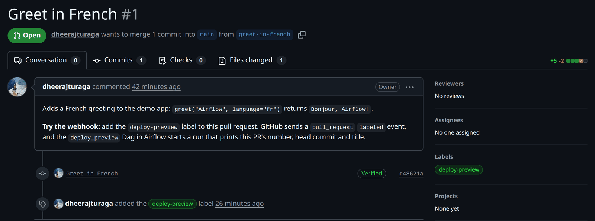
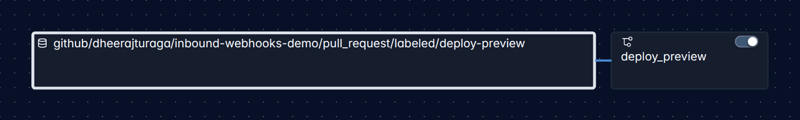
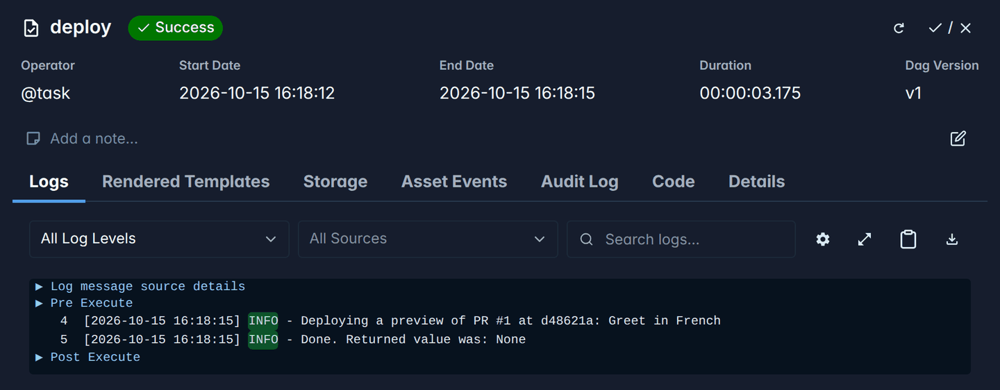
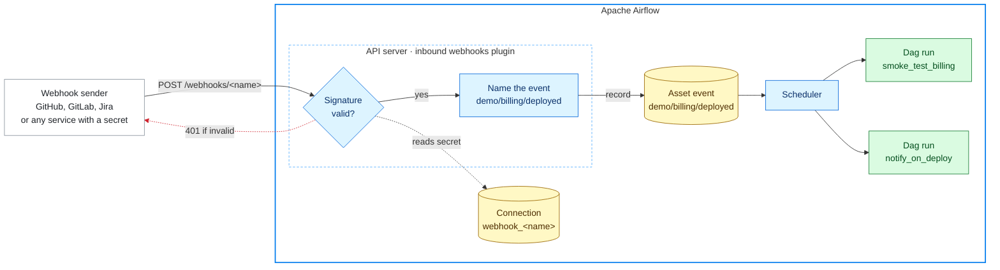
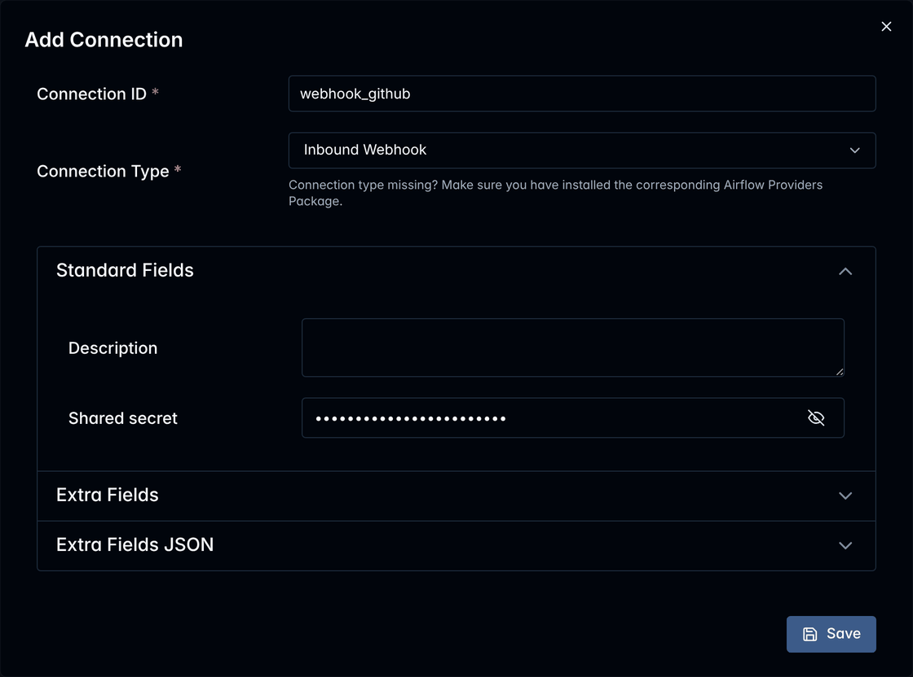
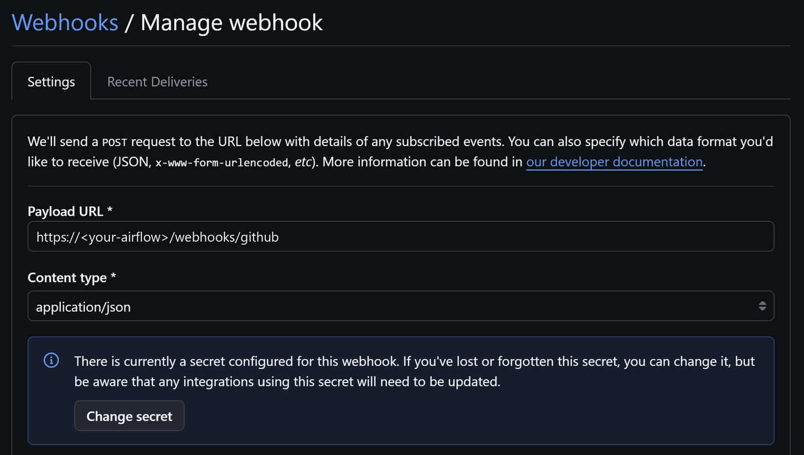
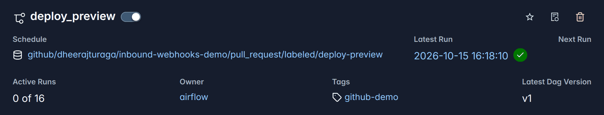

<p align="center">
  <picture>
    <source media="(prefers-color-scheme: dark)" srcset="docs/images/logo-dark.svg">
    
  </picture>
</p>

<h3 align="center">Turn incoming webhooks into asset events that trigger your Airflow Dags.</h3>

<p align="center">
  <a href="https://github.com/dheerajturaga/airflow-provider-inbound-webhooks/actions/workflows/ci.yml"></a>
  <a href="https://pypi.org/project/airflow-provider-inbound-webhooks/"></a>
  <a href="https://pypi.org/project/airflow-provider-inbound-webhooks/"></a>
  
  
</p>

`airflow-provider-inbound-webhooks` lets any service that can send a signed or secret-carrying
webhook trigger your [Apache Airflow](https://airflow.apache.org/) Dags.

Each verified delivery becomes an **asset event**, named after what happened. A Dag subscribes by
scheduling on that name, and Airflow does the rest. There is no routing code to write, and adding a
sender is one Airflow connection.

GitHub, GitLab and Jira are built in. Any other service that signs its deliveries with HMAC-SHA256
or sends a secret header works too, described in its connection.

## See it work

Someone adds the `deploy-preview` label to a pull request in GitHub:



GitHub's delivery becomes an event on the asset
`github/dheerajturaga/inbound-webhooks-demo/pull_request/labeled/deploy-preview`, which the
`deploy_preview` Dag schedules on:



So `deploy_preview` runs, with the pull request from the delivery's payload:



Here is that Dag. `WebhookTopic` builds the name it schedules on from its parts; a plain
`Asset("github/dheerajturaga/inbound-webhooks-demo/pull_request/labeled/deploy-preview")` matches
the same deliveries:

```python
from airflow.sdk import dag, task

from airflow_inbound_webhooks import WebhookTopic

preview_requested = WebhookTopic(
    webhook="github",
    path="dheerajturaga/inbound-webhooks-demo",
    event="pull_request",
    action="labeled",
    detail="deploy-preview",
)


@dag(schedule=preview_requested)
def deploy_preview():
    @task
    def deploy(*, triggering_asset_events=None):
        for event in triggering_asset_events[preview_requested]:
            pr = event.extra["payload"]["pull_request"]
            print(f"Deploying a preview of PR #{pr['number']} at {pr['head']['sha'][:7]}: {pr['title']}")

    deploy()


deploy_preview()
```

The repository and its Dags are in
[dheerajturaga/inbound-webhooks-demo](https://github.com/dheerajturaga/inbound-webhooks-demo).

## Why

Airflow can be triggered from outside through its REST API, but webhook senders can't use it: they
cannot obtain or attach an Airflow API token. They sign their requests with a shared secret instead,
and each service posts its own payload format. The usual workarounds are a relay service in front of
Airflow, or sensors that poll the other service and hold worker or triggerer capacity while they
wait.

This plugin adds the missing piece: an endpoint on the Airflow API server that verifies each
service's signature and records the delivery as an asset event.

## How it works



The plugin never runs Dags itself. It records asset events, Airflow queues every Dag that schedules
on them, and the scheduler creates the runs. So one delivery can start several Dags, and asset
expressions such as `a | b` work as usual. Events are only recorded on names that a Dag that is not
paused schedules on, so a delivery that only paused Dags subscribe to records nothing, and unpausing
a Dag never replays such a delivery; see [When Dags run](docs/writing-dags.md#when-dags-run) for
what a Dag gets of events recorded while it was paused.

A delivery offers several names, from broad to specific, such as `github/*/pull_request` and
`github/my-org/web/pull_request/labeled/deploy-preview`, so a Dag subscribes as broadly or as
narrowly as it needs; [Event names](docs/event-names.md) gives the rule.

## Install

On the machine running the Airflow API server, with Airflow 3.1.1 or later, install the plugin and
create its table in Airflow's metadata database:

```bash
pip install airflow-provider-inbound-webhooks "apache-airflow==$(airflow version)"
airflow db migrate
```

Pinning `apache-airflow` to the version you run keeps pip from changing it. On Airflow 3.1,
`airflow db migrate` only creates the table once `external_db_managers` names the plugin; see
[Compatibility](docs/compatibility.md). Dag files that import `WebhookTopic` also need the package
wherever they are parsed: on the Dag processor and the workers.

To try it without a service account, the [quick start](docs/quick-start.md) sends a signed test
delivery from the command line.

## Connect a service

Every service takes the same steps: in Airflow, enable the webhook's name and create a connection
holding a secret; in the service, add a webhook with that secret; then, in Airflow, schedule a Dag on
one of its events.

| Service | Source type | Setup |
|---|---|---|
| GitHub | `github`, built in | [Connect GitHub](#connect-github), below |
| GitLab | `gitlab`, built in | [Connect GitLab](docs/connecting.md#connect-gitlab) |
| Jira | `jira`, built in | [Connect Jira](docs/connecting.md#connect-jira) |
| Any service that signs the body with HMAC-SHA256, or sends a secret in a header | `hmac_json` or `token_header`, described in the connection | [Connect any other service](docs/connecting.md#connect-any-other-service) |

More built-in services are on the way. To ask for one, [open a feature
request](https://github.com/dheerajturaga/airflow-provider-inbound-webhooks/issues/new?template=feature_request.yml)
with a link to the service's webhook documentation.

The service must be able to reach the API server. A cloud service, such as GitHub.com, needs a
public HTTPS address: put a reverse proxy in front of the API server that forwards only the paths of
your webhooks, such as `/webhooks/github` (see [Security](docs/security.md)). `<your-airflow>` below
stands for that address.

### Connect GitHub

**In Airflow**

1. Add `github` to [`webhook_names`](docs/reference.md#configuration), the comma-separated list in
   `airflow.cfg`, and restart the API server.

2. Create the connection `webhook_github` with a new secret, and copy the secret it prints:

   ```bash
   SECRET="$(openssl rand -hex 32)" && echo "$SECRET"
   airflow connections add webhook_github --conn-type inbound_webhook --conn-password "$SECRET"
   ```

   <details>
   <summary>Or in the Airflow UI</summary>

   Under Admin → Connections, add a connection of type **Inbound Webhook** with the Connection Id
   `webhook_github`, and a new secret, such as one from `openssl rand -hex 32`, as its shared secret:

   

   </details>

**In GitHub**

3. In the repository, open **Settings → Webhooks → Add webhook**. To cover every repository of an
   organization, use the organization's **Settings → Webhooks** instead, as an organization owner.

4. Fill in the form, then select **Add webhook**:

   | Field | Value |
   |---|---|
   | Payload URL | `https://<your-airflow>/webhooks/github` |
   | Content type | `application/json`. The default, `application/x-www-form-urlencoded`, is refused. |
   | Secret | The secret from step 2 |
   | Which events would you like to trigger this webhook? | **Let me select individual events**, then the ones your Dags need, such as *Pull requests* or *Pushes* |
   | Active | Checked |

   

5. Check it. GitHub sends a `ping` right away: on the webhook's **Recent Deliveries** tab it should
   have a green check, and its response should be `202` with `"outcome":"no_subscribers"`.

**In Airflow**

6. Add a Dag that schedules on an event, such as
   `Asset("github/my-org/web/pull_request/labeled/deploy-preview")`, and unpause it. To find a name,
   trigger the event once and copy one of the names it offered from its delivery under
   **Browse → Webhook deliveries**, which you can search by the `delivery_id` of its response. That
   needs permission to read the connection `webhook_github`; anyone can build a name as
   [Event names](docs/event-names.md) describes. The Dag's page shows the name it schedules on:

   

## Documentation

| Page | What it covers |
|---|---|
| [Quick start](docs/quick-start.md) | Trying the plugin locally with its test sender, no service account needed |
| [Connecting services](docs/connecting.md) | GitLab, Jira and any other service, step by step |
| [Event names](docs/event-names.md) | How deliveries are named, how to find a name, and the names GitHub, GitLab and Jira deliveries offer |
| [Writing Dags](docs/writing-dags.md) | `WebhookTopic`, the payload and the keys of each event's `extra`, when Dags run, and the checks of Dags that use topics |
| [Reference](docs/reference.md) | Source types and their options, the connection, configuration, delivery records, the deliveries page and API, the command line, audit log and metrics, responses and troubleshooting |
| [Security](docs/security.md) | What the endpoint exposes, secrets, payloads and replays, and the limitations |
| [Compatibility](docs/compatibility.md) | Supported Airflow versions, the public interfaces versioning covers, and the FAQ |
| [Design notes](docs/design.md) | How the plugin works inside, for contributors |

## Compatibility

Airflow 3.1.1 and later, on the Python versions each supports. Airflow 3.1 needs one extra
setting; [Compatibility](docs/compatibility.md) has the details for each version.

## Who uses it

Organizations that use this provider are listed [in the wild](INTHEWILD.md). If yours does, open a
pull request that adds it to the list.

## Contributing

See [CONTRIBUTING.md](CONTRIBUTING.md) for development setup, tests and adding a source type, and
[CHANGELOG.md](CHANGELOG.md) for changes.

## License

[Apache License 2.0](LICENSE).

Apache Airflow, Airflow, Apache, the Apache feather logo, and the Apache Airflow project logo are
either registered trademarks or trademarks of The Apache Software Foundation in the United States
and other countries. This project is not affiliated with or endorsed by The Apache Software
Foundation.
